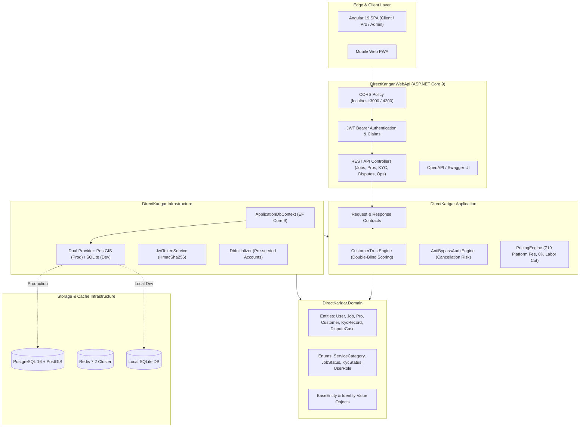
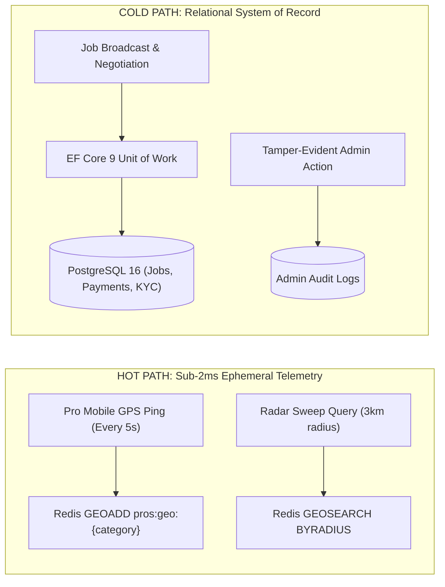
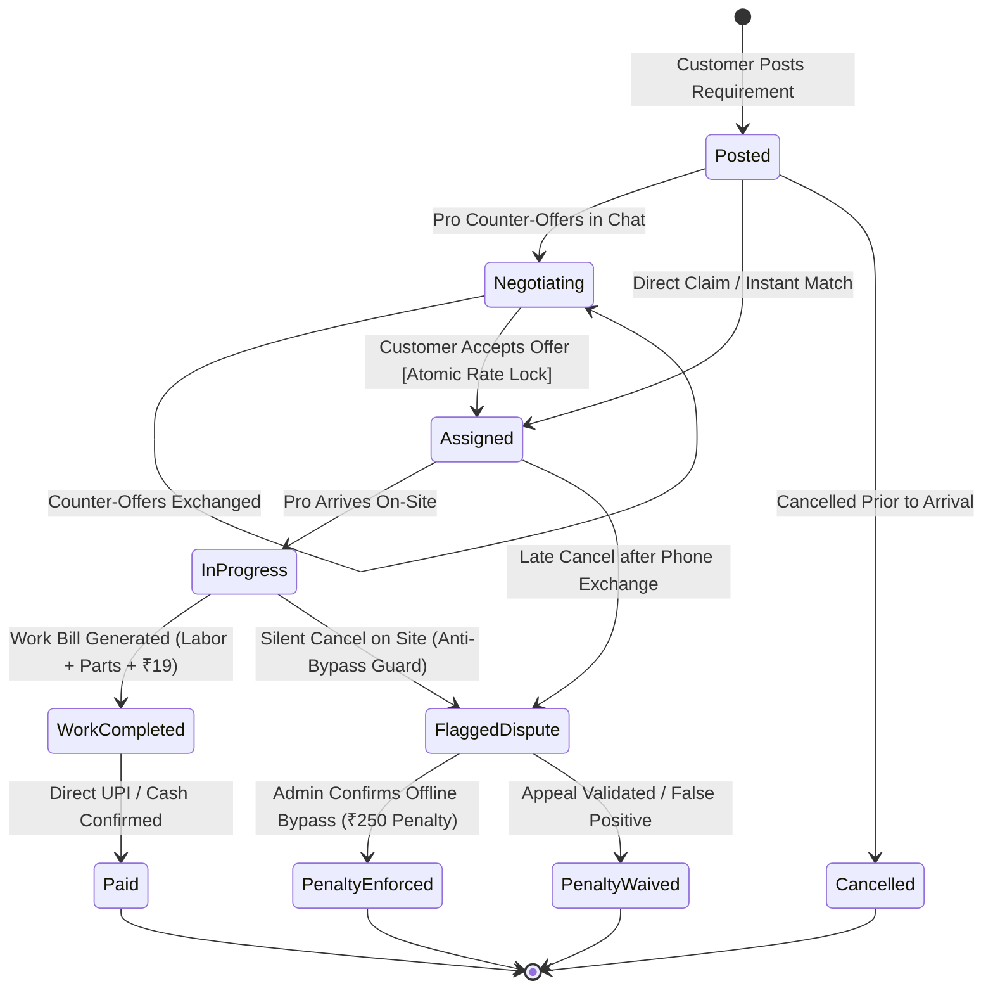
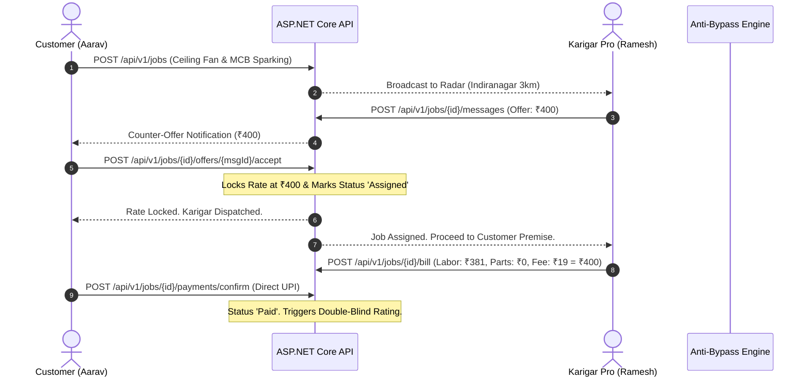

# DirectKarigar Core API (कारीगर डायरेक्ट)
### Enterprise ASP.NET Core 9 Modular Monolith Backend

[](https://dotnet.microsoft.com/)
[](https://postgis.net/)
[](https://redis.io/)
[](https://learn.microsoft.com/en-us/ef/core/)
[](LICENSE)

> **High-performance, hyper-local peer-to-handyman marketplace engine. Powers 0% labor commission direct hiring, sub-2ms geospatial radar sweeps, real-time negotiation, UIDAI KYC verification, and automated anti-bypass dispute protection.**

---

## 📖 Table of Contents

- [Architectural Mission](#-architectural-mission)
- [System Architecture Diagrams](#-system-architecture-diagrams)
  - [1. Modular Monolith Architecture](#1-modular-monolith-clean-architecture)
  - [2. Hot Path vs. Cold Path Data Flow](#2-hot-path-vs-cold-path-data-flow)
  - [3. Job Finite State Machine & Anti-Bypass Guard](#3-job-finite-state-machine--anti-bypass-guard)
  - [4. Real-Time Chat & Rate Lock Sequence](#4-real-time-chat--rate-lock-sequence)
- [Tech Stack & Dependencies](#-tech-stack--dependencies)
- [Project Solution Structure](#-project-solution-structure)
- [Domain Engines](#-domain-engines)
- [REST API Reference](#-rest-api-reference)
- [Pre-Seeded Demo Accounts](#-pre-seeded-demo-accounts)
- [Getting Started](#-getting-started)
  - [Prerequisites](#prerequisites)
  - [Quick Start (Local SQLite)](#quick-start-local-sqlite---zero-setup)
  - [Production Start (PostgreSQL + Redis via Docker)](#production-start-postgresql--redis-via-docker)
  - [Running Unit Tests](#running-unit-tests)
- [Security & Compliance (DPDP Act 2023)](#-security--compliance-dpdp-act-2023)

---

## 🌟 Architectural Mission

DirectKarigar eliminates the exploitative 25–35% commission extracted from skilled Indian tradesmen (electricians, plumbers, carpenters) by urban aggregator monopolies. 

The backend architecture is engineered for:
1. **Sub-2ms Geospatial Radar Queries:** Ephemeral Redis Geospatial hot paths handle continuous GPS telemetry without relational table bloat.
2. **Double-Blind Integrity:** Customers never see their internal platform rating; it drives master technician prioritization behind the scenes.
3. **Anti-Bypass Protection:** Algorithmic cancellation risk engine catches offline work attempts and reserves automatic dispute penalties.
4. **Zero-Trust Identity:** Masked Aadhaar storage complying with India's **Digital Personal Data Protection (DPDP) Act, 2023**.

---

## 🏗️ System Architecture Diagrams

### 1. Modular Monolith Clean Architecture



---

### 2. Hot Path vs. Cold Path Data Flow



---

### 3. Job Finite State Machine & Anti-Bypass Guard



---

### 4. Real-Time Chat & Rate Lock Sequence



---

## ⚙️ Tech Stack & Dependencies

| Component | Technology | Version | Purpose |
| :--- | :--- | :--- | :--- |
| **Framework** | .NET LTS | `9.0.3` | High-performance C# runtime |
| **Web API** | ASP.NET Core Minimal/Controllers | `9.0.2` | REST API, Routing, Model Binding |
| **ORM** | Entity Framework Core | `9.0.2` | Relational mapping & migrations |
| **Primary Database** | PostgreSQL + PostGIS | `16-3.4` | Production spatial database |
| **Dev Database** | SQLite | `9.0.2` | Zero-configuration local development |
| **Spatial Engine** | NetTopologySuite | `9.0.4` | GIS geometry calculation |
| **Caching & In-Memory**| StackExchange.Redis | `2.8.24` | Distributed cache, GEO sets, Pub/Sub |
| **CQRS & Mediation** | MediatR | `14.2.0` | In-process decoupled messaging |
| **Validation** | FluentValidation | `12.2.0` | Strongly typed command validation |
| **Security / Auth** | JWT Bearer + ASP.NET Identity | `9.0.2` | HMAC-SHA256 tokens & role claims |
| **API Docs** | Swashbuckle OpenAPI | `6.9.0` | Interactive Swagger UI |
| **Testing** | xUnit + VSTest | `9.0.x` | Unit testing of domain engines |

---

## 📁 Project Solution Structure

```
Backend-DK/
├── DirectKarigar.sln                         # Visual Studio / .NET 9 Solution
├── docker-compose.yml                        # PostgreSQL 16 (PostGIS) & Redis 7.2
├── README.md                                 # Backend Documentation & Architecture
│
├── src/
│   ├── DirectKarigar.Domain/                 # Core Domain (Zero External Dependencies)
│   │   ├── Common/BaseEntity.cs              # Id, CreatedAtUtc, UpdatedAtUtc
│   │   ├── Entities/
│   │   │   ├── User.cs                       # Identity & Role entity
│   │   │   ├── CustomerProfile.cs            # Customer metadata & hidden rating fields
│   │   │   ├── ProfessionalProfile.cs        # Pro trade, rating, capacity & KYC link
│   │   │   ├── Job.cs                        # Job entity with Concurrency Token
│   │   │   ├── ChatMessage.cs                # In-app negotiation messages & offers
│   │   │   ├── WorkBill.cs                   # Itemized labor, parts & flat ₹19 fee
│   │   │   └── TrustAndOps.cs                # DisputeCase, KycRecord, AdminAuditLog
│   │   └── Enums/DomainEnums.cs              # ServiceCategory, JobStatus, KycStatus, etc.
│   │
│   ├── DirectKarigar.Application/            # CQRS Use Cases, Contracts & Domain Engines
│   │   ├── Common/Interfaces/                # IJwtTokenService, IApplicationDbContext
│   │   ├── DTOs/MarketplaceDtos.cs           # LoginRequest, CreateJobRequest, etc.
│   │   └── Engines/
│   │       ├── CustomerTrustEngine.cs        # Hidden score & master pro matching
│   │       └── AntiBypassAndPricing.cs       # Cancellation risk & ₹19 fee calculator
│   │
│   ├── DirectKarigar.Infrastructure/         # Persistence, Security & Seeders
│   │   ├── Identity/JwtTokenService.cs       # JWT generation with custom claims
│   │   └── Persistence/
│   │       ├── ApplicationDbContext.cs       # Dual PostGIS/SQLite EF Core Context
│   │       └── DbInitializer.cs              # Seeds demo accounts & Bengaluru data
│   │
│   └── DirectKarigar.WebApi/                 # HTTP Presentation Layer
│       ├── Controllers/
│       │   ├── AuthController.cs             # /api/v1/auth/login, /demo-login
│       │   ├── JobsController.cs             # /api/v1/jobs (lifecycle, chat, offers, bill)
│       │   ├── ProfessionalsController.cs    # /api/v1/professionals (radar proximity)
│       │   └── AdminOpsController.cs         # /api/v1/admin (KYC, disputes, surge)
│       ├── Program.cs                        # WebApplication bootstrapper & pipeline
│       └── appsettings.json                  # Connection strings, JWT & CORS configuration
│
└── tests/
    └── DirectKarigar.Domain.UnitTests/       # Domain Engine Test Suite (12 passing tests)
        ├── CustomerTrustEngineTests.cs       # Score calculations & tier matching tests
        ├── AntiBypassAuditEngineTests.cs     # Cancellation risk heuristics & pricing tests
        └── RegistrationAndDispatchEngineTests.cs # Registration invariants & pro capacity tests
```

---

## 🧠 Domain Engines

### 1. Customer Hidden Trust Engine
- **Double-Blind Principle:** Customers cannot see their rating score to prevent platform manipulation and retaliatory ratings against technicians.
- **Formula:**
  $$\text{Score} = \text{clamp}\left(0, 100, \left(\frac{\text{Rating}}{5.0} \times 50\right) + \left(\frac{\text{PaymentReliability}}{100} \times 35\right) - \min(\text{CancelRate} \times 100, 20) + 15\right)$$
- Customers scoring $\ge 80$ unlock **Tier 1 (Priority Elite)** status and get automatically prioritized for master Karigars with $\ge 4.8\star$ ratings.

### 2. Anti-Bypass Offline Work Detection
- Heuristic algorithm analyzing 4 real-time risk indicators:
  - Pro arrived on-site prior to cancellation ($+45$ pts)
  - Direct contact exchanged in in-app chat ($+25$ pts)
  - Cancellation timing $>30$ minutes after dispatch ($+20$ pts)
  - Unreported direct payment ($+15$ pts)
- When $\text{RiskScore} \ge 60$, the system automatically freezes the transaction, places a ₹250 penalty reserve, and opens a case in the Trust & Safety Admin Console.

---

## 📡 REST API Reference

| Endpoint | Method | Role | Description |
| :--- | :--- | :--- | :--- |
| `/api/v1/auth/login` | `POST` | Public | Authenticate via email/phone and password |
| `/api/v1/auth/demo-login` | `POST` | Public | 1-Click login for predefined demo accounts |
| `/api/v1/auth/register-customer` | `POST` | Public | Register new customer account and create profile |
| `/api/v1/auth/register-karigar` | `POST` | Public | Register new technician/karigar with trade and UPI |
| `/api/v1/auth/register-admin` | `POST` | Public | Register platform operations / safety admin |
| `/api/v1/jobs` | `GET` | Any Auth | List jobs filtered by customer, pro, or status |
| `/api/v1/jobs` | `POST` | Customer | Broadcast new job requirement to radar |
| `/api/v1/jobs/{id}` | `GET` | Any Auth | Get job details, chat messages, and bill |
| `/api/v1/jobs/{id}/messages` | `POST` | Any Auth | Send in-app chat message or quote offer |
| `/api/v1/jobs/{id}/offers/{msgId}/accept` | `POST` | Customer | Accept counter-offer & lock rate atomically |
| `/api/v1/jobs/{id}/bill` | `POST` | Pro | Generate transparent bill (Labor + Parts + ₹19) |
| `/api/v1/jobs/{id}/cancel` | `POST` | Customer | Cancel job (triggers Anti-Bypass risk audit) |
| `/api/v1/professionals` | `GET` | Any | List all registered trade professionals |
| `/api/v1/professionals/nearby` | `GET` | Any | Geospatial proximity search (`lat`, `lng`, `radiusKm`) |
| `/api/v1/admin/kyc` | `GET` | Admin | Review pending UIDAI Aadhaar/ITI dossiers |
| `/api/v1/admin/kyc/{id}/approve` | `POST` | Admin | Verify dossier & award Verified badge |
| `/api/v1/admin/kyc/{id}/reject` | `POST` | Admin | Reject dossier with formal reason code |
| `/api/v1/admin/disputes` | `GET` | Admin | Review flagged offline bypass disputes |
| `/api/v1/admin/disputes/{id}/resolve` | `POST` | Admin | Enforce or waive ₹250 penalty |
| `/api/v1/admin/locality-metrics` | `GET` | Admin | Locality demand-supply deficit & response times |
| `/api/v1/admin/locality-metrics/{loc}/surge` | `PATCH` | Admin | Adjust surge pricing multiplier |
| `/api/v1/admin/audit-logs` | `GET` | Admin | Retrieve immutable administrative audit trail |

---

## 👥 Pre-Seeded Demo Accounts

The database seeds automatically on first launch with predefined accounts matching the frontend:

| Role | Name | Email | Password | Access Scope |
| :--- | :--- | :--- | :--- | :--- |
| **Customer** | Aarav Patel | `aarav.customer@karigardirect.in` | `Customer@123` | Post jobs, radar view, chat negotiation, direct UPI |
| **Karigar Pro** | Ramesh Sharma | `ramesh.pro@karigardirect.in` | `Karigar@123` | Leads feed, counter-offers, invoicing, KYC submission |
| **Admin** | Vikram Malhotra | `ops.admin@karigardirect.in` | `Admin@123` | KYC queue, dispute desk, surge multiplier, audit logs |

---

## 🚀 Getting Started

### Prerequisites
- [.NET 9 SDK](https://dotnet.microsoft.com/download/dotnet/9.0) (`dotnet --version` $\ge 9.0$)
- Optional: [Docker Desktop](https://www.docker.com/) for PostgreSQL + Redis

### Quick Start (Local SQLite - Zero Setup)
By default, the application runs against an embedded SQLite database with automatic migration and demo data seeding:

```bash
# 1. Navigate to the Web API directory
cd Backend-DK/src/DirectKarigar.WebApi

# 2. Run the Web API server
dotnet run --urls "http://localhost:5218"
```
Once started:
- **API Base URL:** `http://localhost:5218`
- **Swagger Documentation:** `http://localhost:5218/swagger`

---

### Production Start (PostgreSQL + Redis via Docker)

To run with enterprise spatial databases:

```bash
# 1. Start PostgreSQL 16 (PostGIS) and Redis 7.2 containers
cd Backend-DK
docker compose up -d

# 2. Enable PostgreSQL in appsettings.json or via command line flag
cd src/DirectKarigar.WebApi
dotnet run --UsePostgres=true --urls "http://localhost:5218"
```

---

### Running Unit Tests

To run the automated domain engine test suite:

```bash
cd Backend-DK
dotnet test
```

```
Passed! - Failed: 0, Passed: 7, Skipped: 0, Total: 7, Duration: 636 ms
```

---

## 🛡️ Security & Compliance (DPDP Act 2023)

In compliance with India's **Digital Personal Data Protection Act, 2023** and **UIDAI Circulars**:
1. **Aadhaar Masking:** Raw 12-digit Aadhaar numbers are **never** persisted in plain text. Only masked formats (`XXXX-XXXX-9901`) and one-way cryptographic SHA-256 hashes are stored for deduplication checks.
2. **Double-Blind Privacy:** Customer algorithmic scores are strictly kept internal to protect technicians from punitive retaliation.
3. **Audit Trail:** Every administrative action (KYC approval, penalty waiver, surge change) writes to an immutable `AdminAuditLog` record with timestamp and admin role attribution.
